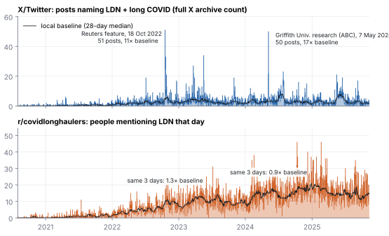
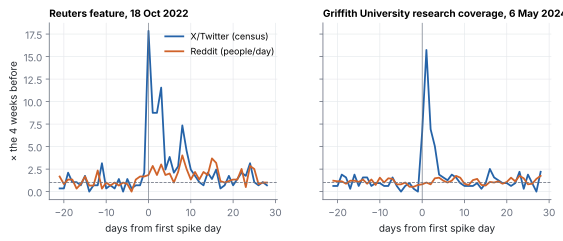
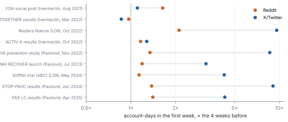
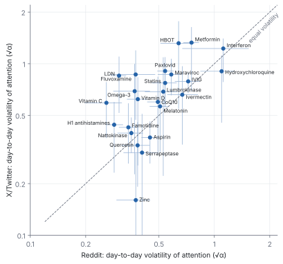
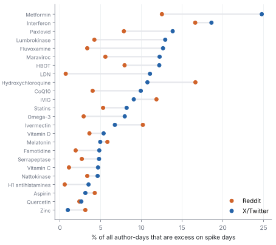
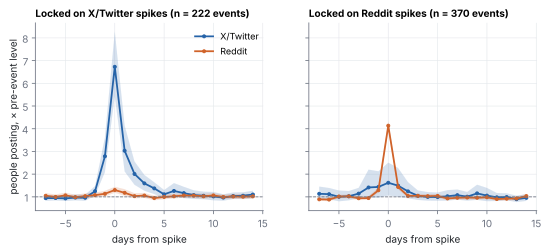
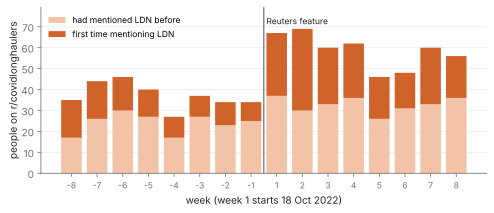
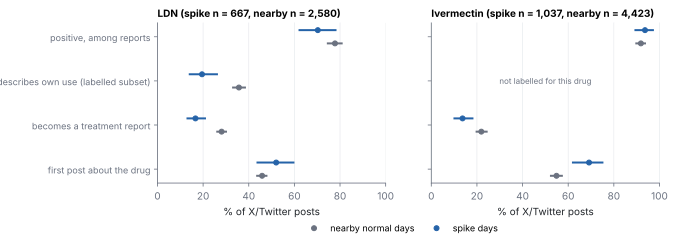
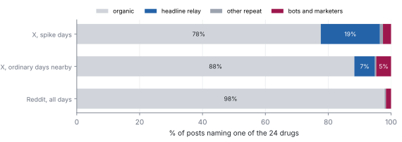

# Spikes on X, steps on Reddit: how the news cycle moves long COVID drug talk

<p class="dek">For five years we counted, day by day, how often people discussed 24 drugs in long COVID conversations on X and on Reddit. On X, attention jumps when a story breaks and is gone within days. Much of each jump is one headline passed between accounts, and the people it brings in rarely return. On Reddit, attention barely moves. In the one clear case where it rose and stayed up, most of the rise came from people mentioning the drug on the subreddit for the first time.</p>

<p class="byline">PatientPunk analysis · data to 11 November 2025 · written 20 November 2026</p>

On 18 October 2022, Reuters published a feature on low-dose naltrexone (LDN) for long COVID. That day, **51** posts on X mentioned LDN and long COVID together, by X's own complete count. The whole week before had **19**. Our separate scrape of that day holds 64 LDN posts, and 12 of them were the same sentence, posted by 12 accounts, nearly all of them radio or news stations. Within three weeks, X was almost back to normal.

The long COVID subreddit, r/covidlonghaulers, reacted later and less, but it didn't fall back. From April to August 2022, 5–6 people a day mentioned LDN there. After the story, 9–10 did, and the number never returned to its old level, though it had already started rising in September.

That contrast, between brief spikes on X and rare lasting changes in level on Reddit (we call these *steps*), is the subject of this post. It matters to anyone who reads social media to learn which treatments patients use.

> **The short version**
>
> - **One story, two shapes.** After the Reuters LDN feature, X ran at **8.3×** its usual weekly volume in week 1 and 1.4× by week 3. On Reddit, LDN account-days (distinct people each day, summed over the week) were **2.1×** normal in week 1 and still **2.0×** in week 3, mostly from people mentioning LDN there for the first time. That is a rise in discussion. The data can't show that the story led anyone to start taking LDN.
> - **Lasting changes like that are uncommon.** Of nine hand-picked releases, the six about LDN and Paxlovid lifted X **3–10×** in their first week; five barely moved Reddit (1.1–1.4×). Across 219 X spikes there is little evidence of an average lasting rise: Reddit two months later was 3% higher than after random dates (95% CI −3% to +9%).
> - **X is more volatile for 18 of 24 drugs.** The median ratio of excess day-to-day variance (α) is **1.6** (95% CI 1.2–2.6), or 1.27 on the √α scale of Figure 4. Much of the gap is one headline posted word for word by many accounts. Count each headline once and the α ratio falls to 1.3, with an interval that includes 1.
> - **Spike-day posts say less about patients.** On LDN spike days, **17%** of X posts are treatment reports (of 667), against 28% on ordinary days nearby (of 2,580). Of posts a classifier labelled, **20%** describe the poster's own use (of 333), against 36% (of 1,283). People whose first post about a drug falls on a spike day are less likely to post about it again.
> - **Posts flagged as bots and marketers don't cause the spikes, but they pad treatment reports.** They are 4.7% of X posts, fewer on spike days, and 220 of 225 spikes are still detected without them. They supply 141 of the 2,186 ivermectin treatment reports on X, all positive: 105 from vendor posts and 36 from single accounts repeating themselves. These are posts our rules flagged, not confirmed fakes.

## Why this matters

PatientPunk reads patient posts to learn which treatments people try and how they work out. Earlier work suggested that Twitter (now X) was more "moved by the news cycle" than Reddit: one LDN story seemed to triple Twitter volume but add only 40% on Reddit. That rested on one event, monthly totals and no stated baseline.

This post tests the idea properly. If press coverage drives X volume more than patient experience does, three things follow for anyone mining X:

1. Raw volume is a poor guide to how many patients use a drug.
2. Any trend in sentiment or uptake built from X will follow the news calendar.
3. Posts written during a spike come from a different crowd, and mixing them in dilutes the patient signal.

## Data

| Source | What it counts | Span | Size |
|---|---|---|---|
| **X full-archive counts** (X API `counts/all`) | Daily number of posts matching `(LDN OR naltrexone) ("long covid" OR longcovid OR LC OR PASC) -is:retweet`. A complete count for that query, not a sample. | Jan 2020–Nov 2025 | 5,150 posts |
| **X keyword corpus** | A scrape for 88 drug keywords. Every query paired a drug with a long COVID term. Includes the 280-character text, likes and author handle. | Jan 2020–Nov 2025 | 87,041 posts, 32,515 accounts |
| **r/covidlonghaulers** | The whole subreddit: every submission and comment, plus PatientPunk's 12,217 LDN treatment reports | Jul 2020–Nov 2025 | 1,854,693 posts, 69,137 accounts |

We analyse both platforms over the same 1,929 days, **1 August 2020 to 11 November 2025**, in UTC calendar days. Drug names come from the scrape's own keywords, grouped into 27 drugs (for example `paxlovid|nirmatrelvir` and `famotidine|pepcid`) and matched the same way on both platforms. Generic words such as "antiviral" and "cytokine" are left out. Three drugs with fewer than 300 Reddit mentions (azithromycin, Evusheld and remdesivir) are dropped from the cross-drug comparisons, leaving 24.

The two platforms hold different people. The subreddit is a patient community: almost everyone there has, or believes they have, long COVID. The X data is anyone who wrote a drug name next to a long COVID term: patients, but also journalists, clinicians, advocates, sceptics, sellers and news outlets. Part of what we measure is this difference in who is talking.

They are also sampled differently, in a way that makes X look worse as a patient source. Every X post had to name the drug *and* long COVID. A Reddit comment only has to name the drug, because the whole subreddit is about long COVID. Headlines name the condition; patients discussing their dose often don't. When we pulled every LDN post from 70 X accounts, 79% were missing from our corpus, almost all because they lacked a long COVID term (only 15 of the 618 missing posts named it), including posts about dose changes, side effects and crashes. The X corpus therefore over-represents headlines and under-represents everyday treatment talk. Every result below describes these two corpora, not X and Reddit as a whole.

**What we count.** Our main measure is the number of **distinct accounts** that mention a drug each day. One account mentioning a drug on one day is an *account-day*. Summed over a week, someone who posts on three days counts three times. Counting posts instead would let one long thread, one bot or one busy comment chain look like a surge: on 24 August 2024, 275 aspirin posts came from just two accounts, and in the week of 31 May 2021 one account wrote 107 of 189 ivermectin posts, all opening with the same line. Counting accounts misses one case: a dozen radio stations posting the same sentence are a dozen accounts. Counting distinct texts catches that. For LDN it gives the same answer (see Robustness); across drugs it matters more (see Bots, marketers and copy-paste). Throughout, "people" and "accounts" mean the same thing: distinct accounts.

## One drug, two platforms: LDN

LDN is the cleanest test. The X API gives a **complete daily count** of posts naming LDN alongside long COVID, so gaps in our scrape don't matter, and we have every Reddit comment. Month by month, our scraped X posts track the complete count closely (Pearson r = 0.85), so the scrape is a reasonable stand-in for monthly and weekly patterns in other drugs. Day by day it is patchier: on 126 days the complete count had at least one LDN post and the scrape had none.



<p class="caption"><b>Figure 1.</b> Daily LDN discussion. Top: every X post naming LDN and long COVID (X API full-archive count). Bottom: distinct people mentioning LDN on r/covidlonghaulers each day. The black line is the local baseline: the median of the 28 surrounding days, excluding the day itself. Reddit discussion grows steadily over five years. After 2022, X stays flat apart from spikes.</p>

The two series describe the same drug for the same illness, yet look nothing alike. On Reddit, LDN discussion grows from almost nothing in 2021 to 15–20 people a day in 2025, with small daily wobbles around a slowly rising level. On X, after rising to about 3 posts a day in 2022, there is no trend: 3–4 posts a day, broken by single days of 20–50.

To find what caused each X spike without labelling posts by hand, we compared the words in spike-day posts with those in all LDN posts. The table lists the eight biggest spikes in the complete count, their most over-represented words, and what Reddit did over the same three days.

<!-- table:events -->
| Spike (UTC) | X posts that day (baseline) | X, 3 days vs baseline | Reddit account-days, same 3 days | Distinctive words in the X posts |
|---|---|---|---|---|
| 2024-05-07 | 50 (3.0) | **10.3×** (99th pct) | 0.87× (32nd pct) | abc, university, griffith, researchers, trial, patients |
| 2022-10-18 | 51 (4.5) | **7.0×** (97th pct) | 1.32× (75th pct) | lifting, promise, addiction, shows, fog, drug |
| 2023-05-18 | 34 (3.0) | **6.3×** (97th pct) | 1.17× (63rd pct) | few, use, brain, low-dose, used, pain |
| 2023-03-22 | 27 (4.0) | **4.8×** (95th pct) | 1.27× (71st pct) | treat, longcovid |
| 2023-10-31 | 19 (3.0) | **3.8×** (94th pct) | 1.48× (83rd pct) | used, brain |
| 2022-07-05 | 19 (3.0) | **3.1×** (92nd pct) | 1.17× (62nd pct) | clotting, off, treatment, used, pain, longcovid |
| 2024-07-27 | 23 (6.5) | **2.8×** (90th pct) | 0.97× (42nd pct) | *none: no scraped posts that day* |
| 2025-05-16 | 21 (5.0) | **2.5×** (88th pct) | 0.98× (42nd pct) | calcium, trpm, ion, channel, function, low-dose |
<!-- /table -->

<p class="caption">"3 days vs baseline" adds up the spike day and the next two days and divides by their baselines. The percentile ranks that ratio against all of the roughly 1,900 three-day windows in the same series, so each spike is compared with every other stretch of time. Words come from the scraped posts and had to appear in at least 15% of that window's posts.</p>

The words point to the stories. **"Addiction drug shows promise lifting long COVID brain fog, fatigue"** is the [Reuters feature of 18 Oct 2022](https://www.yahoo.com/news/addiction-drug-shows-promise-lifting-101204918.html). **"ABC, Griffith, university, researchers, trial"** in May 2024 is the [ABC's report](https://www.abc.net.au/news/2024-05-07/qld-griffith-university-trial-naltrexone-long-covid/103800050) on Griffith University's naltrexone trial. **"Calcium, TRPM, ion channel"** in May 2025 matches Griffith's laboratory work on LDN and the TRPM3 ion channel, but we haven't found the specific announcement, so that label is a guess from the words alone. The other spikes don't point to a single story.

On X, the biggest spikes rank in the top 1–3% of all three-day windows. Over the same days, Reddit never reaches its own top 15%, and three times it is **below** normal. Reddit didn't spike. But a three-day window can miss a different kind of response: a lasting change in level. That is what happened after Reuters.



<p class="caption"><b>Figure 2.</b> The two biggest LDN events, each shown as a multiple of the platform's average in the four weeks before (days −35 to −8). Day 0 is the first spike day. After Reuters (left), X falls back within days, while Reddit stays above its old level for the following month (weeks 2–4 average 2.0×). After the Griffith coverage (right), X drops below its old level after the first week.</p>

### The Reuters weeks

Here are the weeks after the story, each compared with the average of the four weeks before. Reddit's 86 and 94 account-days in weeks 1 and 2 came from 67 and 69 distinct accounts.

<!-- table:reuters_weeks -->
| Series | Weekly baseline | Week 1 | Week 2 | Week 3 |
|---|---:|---:|---:|---:|
| <span class="tw">X full count</span>, posts | 19.0 | 158 (**8.3×**) | 59 (3.1×) | 27 (1.4×) |
| <span class="tw">X scraped corpus</span>, account-days | 15.0 | 144 (**9.6×**) | 54 (3.6×) | 28 (1.9×) |
| <span class="tw">X</span>, posts that became treatment reports | 4.0 | 13 (**3.2×**) | 13 (3.2×) | 9 (2.2×) |
| <span class="rd">Reddit</span>, account-days mentioning LDN | 40.8 | 86 (**2.1×**) | 94 (2.3×) | 80 (2.0×) |
| <span class="rd">Reddit</span>, LDN treatment reports | 25.5 | 56 (**2.2×**) | 63 (2.5×) | 37 (1.5×) |
| <span class="rd">Reddit</span>, <em>all</em> subreddit activity | 8,736.8 | 9,757 (**1.1×**) | 10,135 (1.2×) | 9,671 (1.1×) |
<!-- /table -->

<p class="caption">Week 1 starts on publication day, 18 Oct 2022. Treatment reports are posts from which PatientPunk's pipeline extracted an LDN report (X: run 4; Reddit: run 2).</p>

X spikes and fades. Reddit rises far less (2.1× against 9.6× in account-days), peaks in the *second* week (on 26 October, eight days after the story) and is still at twice its old level in week 3. The subreddit as a whole was only 11–16% busier, so the rise is specific to LDN. It also lasted: Reddit's LDN discussion ran at 5.0–6.0 people a day from April to August 2022 and at 9.0–9.9 from October to December, and never returned to the old level. X's complete count fell from 8.5 posts a day in October back to 3.8 in November.

Posts describing LDN use rose too: posts from which the pipeline extracted an LDN treatment report doubled in the first two weeks, though those reports can describe use that began long before the story. On X, posts that became treatment reports rose from 4 a week to 13, but all posts rose much faster, so reports fell from about a quarter of posts to under a tenth.

Two cautions. First, Reddit's LDN discussion was already rising in September (7.0 people a day), so Reuters can't take credit for the whole step. Second, the earlier monthly observation holds up under a proper test. October 2022 against July–September gives **2.74×** for the complete X count (exact Poisson 95% CI 2.31–3.25) and **1.50×** for Reddit people (1.30–1.74), with the whole subreddit at 1.13×. The earlier figures were close: about 3× on X and 1.5× on Reddit, against the 3× and 1.4× first reported. They just described a spike on one platform and a step on the other.

## Nine dated releases, including the ones that did nothing

Spikes found by searching for spikes can only show news that worked. So we also took nine releases by publication date, whatever volume followed: trial results, agency announcements and press features about LDN, Paxlovid and ivermectin. We measured each the same way on both platforms, in UTC days. (The ABC's Griffith report went online at 19:34 UTC on 6 May 2024, so we date it 6 May, though X spiked on the 7th.)

This is a hand-picked case series, not a sample. We had no written rule for what qualifies, and eligible releases are missing. One is the [LDN pilot study](https://pubmed.ncbi.nlm.nih.gov/35814187/) published online on 3 July 2022, which may be behind the 5 July X spike in the table above. Measured the same way afterwards, its first week fits the pattern: 3.4× on X (96th percentile) and 1.05× on Reddit (55th). Reddit's weeks 2–4 then ran at 1.4×, so it may have had a delayed response.



<p class="caption"><b>Figure 3.</b> Account-days (distinct accounts each day, summed) mentioning the drug in the seven days from the release date, as a multiple of the average of the four weeks before. Log scale.</p>

<!-- table:dated -->
| Release | Drug | Date | X account-days, week 1 | Reddit account-days, week 1 | X, weeks 2–4 | Reddit, weeks 2–4 |
|---|---|---|---:|---:|---:|---:|
| FDA social post | Ivermectin | 2021-08-21 | **1.1×** (67th pct) | 1.6× (85th pct) | 0.9× | 1.1× |
| TOGETHER results | Ivermectin | 2022-03-30 | **0.9×** (40th pct) | 1.0× (50th pct) | 0.8× | 1.4× |
| Reuters feature | LDN | 2022-10-18 | **9.6×** (99th pct) | 2.1× (94th pct) | 2.4× | 2.0× |
| ACTIV-6 results | Ivermectin | 2022-10-21 | **1.3×** (77th pct) | 1.2× (64th pct) | 0.9× | 0.6× |
| VA prevention study | Paxlovid | 2022-11-06 | **8.6×** (99th pct) | 1.3× (76th pct) | 1.8× | 1.5× |
| NIH RECOVER launch | Paxlovid | 2023-07-31 | **3.2×** (95th pct) | 1.2× (67th pct) | 2.0× | 1.7× |
| Griffith trial (ABC) | LDN | 2024-05-06 | **4.3×** (98th pct) | 1.1× (67th pct) | 0.9× | 1.2× |
| STOP-PASC results | Paxlovid | 2024-06-07 | **9.1×** (99th pct) | 1.4× (79th pct) | 1.4× | 0.8× |
| PAX LC results | Paxlovid | 2025-04-03 | **4.3×** (97th pct) | 1.4× (80th pct) | 1.4× | 0.7× |
<!-- /table -->

<p class="caption">The percentile ranks each week-1 lift against every seven-day window of the same series, each measured against its own previous four weeks. "Weeks 2–4" is the average of the following three weeks against the same baseline. Sources: <a href="https://www.fda.gov/media/160265/download">FDA</a>, <a href="https://www.nejm.org/doi/full/10.1056/NEJMoa2115869">TOGETHER</a>, <a href="https://www.yahoo.com/news/addiction-drug-shows-promise-lifting-101204918.html">Reuters</a>, <a href="https://jamanetwork.com/journals/jama/fullarticle/2797483">ACTIV-6</a>, <a href="https://news.va.gov/press-room/paxlovid-reduces-risk-of-long-covid/">VA</a>, <a href="https://recovercovid.org/news/nih-launches-long-covid-clinical-trials-through-recover-initiative-opening-enrollment">NIH RECOVER</a>, <a href="https://www.abc.net.au/news/2024-05-07/qld-griffith-university-trial-naltrexone-long-covid/103800050">ABC</a>, <a href="https://pmc.ncbi.nlm.nih.gov/articles/11161857/">STOP-PASC</a>, <a href="https://medicine.yale.edu/news-article/does-paxlovid-reduce-long-covid-symptoms-yale-led-trial-finds-out/">PAX LC</a>.</p>

Every LDN and Paxlovid release lifted X 3–10× in its first week, each in the top 6% of all weeks. The same weeks on Reddit came in at 1.1–1.4×, between the 67th and 80th percentile: ordinary weeks. Reuters is the one exception (2.1×, 94th percentile).

The three ivermectin releases moved neither platform. All three (the FDA's social media post and the TOGETHER and ACTIV-6 trials) concerned *acute* COVID, and every X query required a long COVID term, so most of that news falls outside our data. That is a limit of the data, not a sign of low interest in ivermectin.

The choice of unit matters even here. Counting posts, the PAX LC results lifted X only 1.5×, because one of the four baseline weeks contained a burst of posts. Counting account-days removes that burst and gives 4.3×.

Reddit's weeks 2–4 ran above normal after four releases: Reuters at 2.0×, NIH RECOVER at 1.7×, the VA study at 1.5× and TOGETHER at 1.4×. Nine events can't separate a delayed response from coincidence, and the tests on all spikes below show that Reddit is usually back to normal within a week.

One contrast is still worth noting, cautiously. For Paxlovid, X jumped for two null trial results (STOP-PASC 9.1×, PAX LC 4.3×) on the same scale as for the positive VA study (8.6×). Reddit's following weeks diverged: above normal after the VA study and the RECOVER launch (1.5× and 1.7×), below normal after the two null results (0.8× and 0.7×). X seems to react to whether something is news; the patient community may react to what the news says.

### What fills the busiest weeks

As a last check, we read the two busiest X weeks for each of the three drugs and counted recurring phrases.

<!-- table:peaks -->
| Drug | Week starting | Posts | Accounts | Most from one account | What was circulating |
|---|---|---:|---:|---:|---|
| LDN | 2022-10-17 | 160 | 135 | 12 | 19 contain “Reuters” or its headline |
| LDN | 2024-05-06 | 96 | 75 | 5 | 29 contain “Griffith” |
| Ivermectin | 2024-05-06 | 409 | 315 | 32 | 192 contain “Cuomo” |
| Ivermectin | 2021-05-31 | 189 | 70 | 107 | 107 contain the opening “another study on ivermectin” |
| Paxlovid | 2022-11-07 | 1,138 | 925 | 12 | 120 contain “VA study”; 391 contain “risk of long COVID” |
| Paxlovid | 2022-04-18 | 610 | 496 | 7 | 149 contain the Reuters headline “the case for testing” |
<!-- /table -->

<p class="caption">Weeks start on Monday (UTC) and are ranked by posts in the scraped corpus. We chose the phrases after reading each week's posts, so they confirm a story rather than discover it. A post that links to a story without using its words isn't counted.</p>

Five of the six peaks trace back to a dated story: the Reuters LDN feature, the ABC report on Griffith, the [VA's release](https://news.va.gov/press-room/paxlovid-reduces-risk-of-long-covid/) on Paxlovid and long COVID risk (6 Nov 2022), a [Reuters feature](https://www.yahoo.com/news/case-testing-pfizers-paxlovid-treating-100343546.html) on testing Paxlovid for long COVID, and an [interview clip](https://www.youtube.com/watch?v=5TP6P_M0jVs) that put "Cuomo" in nearly half of one week's ivermectin posts. The sixth is one account posting the same claim 107 times: a peak in posts can be just one person.

## How we measured news-driven attention

To compare how "spiky" two platforms are, we need a measure that works when their volumes differ a hundredfold. Raw variance doesn't: a drug with 2 posts a day and one with 20 carry different amounts of counting noise, even if interest in both is equally steady. We use two measures instead.

### 1. Volatility of attention, √α

We treat each day's count as random (Poisson) noise around an underlying level of interest. That level is the month's average multiplied by a daily shock: λ_t = m_month · (1 + ε_t). The overdispersion **α = Var(ε)** measures how much interest moves from day to day once the monthly level and counting noise are taken out. We estimate it by the method of moments, pooled over months:

<pre><code>α̂ = Σ_t [ (y_t − ȳ_m)² · n_m/(n_m − 1) − ȳ_m ]  /  Σ_t ȳ_m²</code></pre>

Here y_t is the day's count, ȳ_m the average for its calendar month and n_m the number of days in the month. **√α works like a coefficient of variation.** √α = 0.3 means interest on a typical day is about 30% above or below its monthly level. √α = 1 means 100%, the signature of a series made of quiet days and sudden surges.

Because each month's average is removed, slow growth (like LDN's rise on Reddit) and lasting steps (like the one after Reuters) don't count as volatility. Because expected counting noise is removed, quiet series aren't penalised: thinning each Reddit series down to X's volume changed α by a median of only **0.003** (see Robustness). Confidence intervals come from 1,000 bootstrap samples of whole calendar months.

### 2. Spike share

A day is a **spike** if its count is at least **3×** its local baseline (the median of the 28 surrounding days, excluding the day itself) *and* a count that high would happen by chance less than once in 1,000 times. **Spike share** is the extra volume on spike days as a fraction of all volume: how much of everything said about a drug was surplus on surge days.

For LDN the two platforms are far apart on both measures:

| | <span class="tw">X (full count)</span> | <span class="rd">Reddit (people/day)</span> |
|---|---:|---:|
| Volatility √α, daily | **0.79** | 0.30 |
| Volatility √α, weekly totals within quarters | 0.63 | 0.18 |
| Spike share | **13.1%** | 0.7% |
| Share of volume on the busiest 1% of days | 9.5% | 4.0% |

The weekly row uses weekly totals within quarters, which removes any weekday rhythm. The gap gets wider.

## Across 24 drugs

LDN might be a special case, so we ran the same measures on every drug with enough posts on both platforms.



<p class="caption"><b>Figure 4.</b> Volatility of daily attention (√α, distinct people per day, log scale) on Reddit (x-axis) and X (y-axis). Whiskers are 95% bootstrap intervals over months. Points above the dashed line are more volatile on X.</p>

For **18 of 24 drugs**, attention is more volatile on X than on Reddit. This is the main result. The median ratio of α between X and Reddit is **1.62** (95% bootstrap CI 1.20–2.62; Wilcoxon signed-rank p = 0.0065; sign test p = 0.023), which is 1.27 on the figure's √α scale. Elsewhere in this post, ratios are of α unless they say √α. The typical drug has √α = **0.67** on X and **0.47** on Reddit.

Two checks belong here rather than later. First, much of the gap comes from headlines that many accounts post word for word, usually through a site's share button. Counting each such headline once, X is still more volatile for 16 of 24 drugs, but the median α ratio falls to 1.28 (95% CI 0.89–1.58). The section on bots and copy-paste explains why we still count those shares as news rather than noise.

Second, the sampling difference described under Data doesn't explain the gap. Requiring Reddit posts to name long COVID too, as every X post had to, widens it: X is more volatile for 19 of 24 drugs, with a median α ratio of 3.07 (95% CI 2.36–4.11, Wilcoxon p < 0.001). That filter leaves Reddit only 24,014 posts, so we keep the unfiltered comparison as the main result.

Three patterns stand out in the figure.

- **Both platforms agree on which drugs are "news drugs"** (Spearman ρ = 0.61, p = 0.002). Metformin, HBOT, interferon, hydroxychloroquine and Paxlovid are volatile everywhere, and the press covered their trials and controversies. For Paxlovid we traced the biggest weeks above to the VA study, RECOVER, STOP-PASC and PAX LC. X amplifies the same news that Reddit hears faintly.
- **Everyday staples barely move on either platform.** Zinc, quercetin, serrapeptase, nattokinase, aspirin, famotidine and the H1 antihistamines sit at the lower left: patients take them and discuss them steadily. On Reddit, the most-discussed drugs are the most stable (ρ = −0.63 between Reddit volume and α, p = 0.001). The thinning check rules out a statistical artefact, so heavy, steady use seems to make for a steady conversation.
- **Politicised drugs are the exception.** Hydroxychloroquine, ivermectin and IVIG are as volatile on Reddit as on X, or more so. When a drug becomes a news story in its own right, the news reaches the patient community too.



<p class="caption"><b>Figure 5.</b> Spike share: the percentage of all account-days that are surplus over baseline on spike days.</p>

Spike share tells the same story. It is higher on X for **18 of 24** drugs, by a median factor of 1.65 (95% CI 1.12–2.47, Wilcoxon p = 0.004). For the typical drug, **8.1%** of X attention is surge surplus, against **4.1%** on Reddit. LDN has the widest gap of any drug: 11.1% on X against 0.7% on Reddit.

Unlike α, spike share depends on volume, because a quiet series produces "spikes" by chance. Simulated pure noise at 0.5 posts a day gives a spike share of 1.5%, against 0.2% at 5 a day. X has fewer account-days than Reddit for most drugs, which flatters X a little. Thinning each Reddit series to X's volume still leaves X higher for 19 of 24 drugs, by a median factor of 1.50 (95% CI 1.01–1.76, Wilcoxon p = 0.005): a real but somewhat smaller effect.

<!-- table:drugs -->
| Drug | X account-days | Reddit account-days | X volatility √α (95% CI) | Reddit volatility √α (95% CI) | X spike share | Reddit spike share |
|---|---:|---:|---|---|---:|---:|
| Metformin | 6,225 | 2,636 | 1.33 (0.69–1.64) | 0.75 (0.68–0.83) | 24.8% | 12.5% |
| HBOT | 2,568 | 3,081 | 1.32 (0.54–1.77) | 0.64 (0.51–0.78) | 12.2% | 7.9% |
| Interferon | 783 | 383 | 1.23 (0.78–1.40) | 1.12 (0.67–1.54) | 18.6% | 16.6% |
| Paxlovid | 18,404 | 7,842 | 0.91 (0.56–1.09) | 0.54 (0.49–0.60) | 13.8% | 7.8% |
| Hydroxychloroquine | 1,503 | 838 | 0.90 (0.45–1.12) | 1.09 (0.84–1.29) | 10.7% | 16.6% |
| Maraviroc | 1,153 | 2,388 | 0.87 (0.65–1.07) | 0.58 (0.49–0.66) | 12.2% | 5.6% |
| Fluvoxamine | 1,115 | 2,108 | 0.87 (0.47–1.20) | 0.37 (0.27–0.48) | 12.7% | 3.4% |
| LDN | 3,741 | 17,119 | 0.85 (0.52–1.10) | 0.30 (0.27–0.33) | 11.1% | 0.7% |
| IVIG | 1,291 | 2,868 | 0.79 (0.67–0.89) | 0.72 (0.61–0.83) | 9.1% | 11.8% |
| Statins | 1,228 | 2,841 | 0.77 (0.57–0.97) | 0.54 (0.46–0.62) | 8.2% | 5.3% |
| Omega-3 | 419 | 3,417 | 0.69 (0.23–1.00) | 0.37 (0.28–0.45) | 8.0% | 2.9% |
| Lumbrokinase | 339 | 1,446 | 0.69 (0.22–1.09) | 0.53 (0.42–0.63) | 12.9% | 4.2% |
| Ivermectin | 10,963 | 4,457 | 0.66 (0.34–0.97) | 0.67 (0.55–0.82) | 6.7% | 10.2% |
| Vitamin D | 3,982 | 10,574 | 0.62 (0.26–0.83) | 0.38 (0.33–0.43) | 5.4% | 3.6% |
| CoQ10 | 554 | 3,468 | 0.60 (0.30–0.84) | 0.49 (0.43–0.54) | 9.9% | 4.0% |
| Vitamin C | 1,358 | 4,649 | 0.59 (0.37–0.78) | 0.26 (0.20–0.31) | 4.7% | 1.1% |
| Melatonin | 1,872 | 6,346 | 0.56 (0.31–0.78) | 0.51 (0.45–0.57) | 5.0% | 5.8% |
| H1 antihistamines | 1,815 | 23,055 | 0.44 (0.23–0.60) | 0.29 (0.26–0.32) | 3.5% | 0.6% |
| Famotidine | 877 | 8,249 | 0.43 (0.26–0.59) | 0.34 (0.30–0.38) | 4.8% | 1.9% |
| Nattokinase | 2,464 | 5,635 | 0.39 (0.30–0.49) | 0.35 (0.30–0.41) | 4.6% | 3.4% |
| Aspirin | 1,918 | 6,616 | 0.37 (0.26–0.46) | 0.45 (0.40–0.49) | 3.1% | 4.3% |
| Quercetin | 1,261 | 4,577 | 0.33 (0.19–0.46) | 0.38 (0.31–0.45) | 2.6% | 2.4% |
| Serrapeptase | 657 | 1,624 | 0.30 (0.00–0.51) | 0.40 (0.32–0.49) | 4.8% | 2.7% |
| Zinc | 2,473 | 5,146 | 0.16 (0.00–0.30) | 0.37 (0.29–0.45) | 1.0% | 3.1% |
<!-- /table -->

## When X spikes, what does Reddit do?

The measures so far describe each series on its own. A sharper test lines the two platforms up by date. We took every X spike across the 24 drugs with at least 4 extra people, keeping only the biggest in any 14-day stretch: 222 events. For each, we tracked both platforms from a week before to two weeks after, relative to each platform's level in the preceding four weeks. Then we did the reverse for the 370 Reddit spikes.



<p class="caption"><b>Figure 6.</b> Average daily activity around spikes, as a multiple of each platform's level before the event (days −35 to −8). Ratio of sums over events; bands are 95% bootstrap intervals over events. Left: 222 spikes detected on X. Right: 370 spikes detected on Reddit.</p>

One warning before reading the figure. The platform used to pick the events always peaks on day 0, because the events were chosen for being peaks. So X's 6.7× and Reddit's 4.1× don't show which platform is spikier (α answers that), and they depend on volume, since 4 extra people is a bigger multiple on a quieter series. What the figure shows is **spillover**: how the *other* platform responds.

- **Around X spikes (left):** Reddit reaches **1.30×** its usual level on the same day (95% CI 1.18–1.45) and averages 1.17× over days 0–2. By days 7–14 it averages 1.03×: on average, no delayed rise like the one after Reuters. Reddit notices the stories that light up X, but only faintly.
- **Around Reddit spikes (right):** Reddit's own spikes are over within a day, more like one popular thread than a story everyone is reacting to. X rises to 1.6× on those days (95% CI 1.06–2.5), but it was already at about 1.14× the week *before*, which suggests stories building outside both platforms rather than X reacting to Reddit.
- **Day by day, the two LDN series barely move together.** The correlation of daily "surprise", log((y+1)/(baseline+1)), is at most 0.06 at any lag from −5 to +5 days. (This measure can't see a lasting shift like Reddit's after Reuters.) Outside a few big stories, the two conversations run independently.

## Do spikes become steps?

Reuters is the one case so far where an X spike came with a step on Reddit. How unusual is that? For each of the 219 X spikes with at least eight weeks of data on each side, we compared Reddit's level for that drug one to eight weeks after the spike with the eight weeks before. We measured Reddit as people per subreddit post, so the subreddit's own growth, and its rise and fall with infection waves, cancel out. Then we repeated the comparison on 40 random dates per spike, to see how much Reddit drifts over any eight weeks.

**There is little evidence that X spikes, on average, become Reddit steps.** Reddit's level after an X spike is just **3% higher** than after a random date (95% CI −3% to +9%). Because random dates can fall in a very different year, we repeated the test with comparison dates within 90 days of each spike (excluding two weeks either side): +4% (95% CI −3% to +12%, resampling calendar quarters). A clear step, meaning a rise of at least 1.3× over the eight weeks with p < 0.01, follows 18% of X spikes and 14% of random dates. Reuters, at 1.33× on this measure, is a real but modest example.

The biggest steps that did follow an X spike coincide with changes in access or evidence, not commentary. The largest is Paxlovid at the end of December 2021, just after US authorisation (10.5×, from a very low base). Next come metformin in the winter of 2022–23, ivermectin in December 2020, and Paxlovid again in March and April 2022; the April spike is the Reuters feature on testing Paxlovid for long COVID. One story can move the patient community, but most of what makes X spike never reaches it.

### What made the Reuters step



<p class="caption"><b>Figure 7.</b> Distinct people mentioning LDN on r/covidlonghaulers each week, split into those mentioning it for the first time and those who had mentioned it before. Week 1 starts on 18 October 2022, as in the table above.</p>

The step came mostly from **people mentioning LDN on the subreddit for the first time** (as far back as our data goes): about 13 a week in the eight weeks before the story and 32 a week in the three weeks after, 2.4 times as many. People who had discussed LDN before rose much less, from 24 to 33 a week. Six weeks later, first-timers were still above their old rate.

These newcomers were mostly not new to the subreddit. Of the 96 people whose first LDN mention came in the three Reuters weeks, 31% had first posted there within the previous month, against a median of 41% for the 24 other three-week groups from February 2022 to July 2023. The story mainly turned the attention of patients already in the community to LDN.

Did any of them start taking LDN because of the story? The data can't say. 31 of the 96 had a first model-extracted LDN treatment report within six months, but 16 of those came on the day of their first mention, so they were already describing use. Only 15 (16%) first reported on a later day, about the same as other three-week groups (median 15%), and even those reports can describe earlier use. Because the group was twice the usual size (96 against a median of 46), the story roughly doubled the number of people who started discussing LDN on the subreddit in those weeks. That is the step: more patients already in the community talking about a treatment. Whether it changed what anyone took is beyond this data.

## Who posts during a spike

If spikes just meant more patients talking, they would be harmless for PatientPunk. They don't. We compared X posts written **on spike days** with posts written **on ordinary days within four weeks of a spike**. Keeping the comparison close in time rules out the corpus's growth over the years as an explanation.



<p class="caption"><b>Figure 8.</b> Share of X posts with each property, on spike days (blue) and on ordinary days within ±28 days of a spike (grey), with 95% intervals from a bootstrap that resamples whole days. "Becomes a treatment report" means PatientPunk's sentiment pipeline extracted a report from the post. "Describes own use" comes from a separate personal-use classifier that labelled 2,273 LDN tweets; ivermectin was not labelled.</p>

| | LDN spike | LDN nearby | Difference (95% CI) | Ivermectin spike | Ivermectin nearby | Difference (95% CI) |
|---|---:|---:|---|---:|---:|---|
| Becomes a treatment report | **16.6%** | 28.1% | −11.5 pts (−15.4 to −6.8) | **13.7%** | 21.9% | −8.2 pts (−12.4 to −3.4) |
| Describes the poster's own use | **19.5%** | 35.7% | −16.2 pts (−22.0 to −9.2) | — | — | |
| First post by this person about the drug | 52.0% | 45.9% | +6.2 pts (−2.3 to +14.2) | **69.1%** | 54.9% | +14.3 pts (+6.9 to +21.0) |
| Positive, among reports | 70.3% | 77.8% | −7.5 pts (−16.3 to +0.5) | 93.7% | 91.9% | +1.8 pts (−2.7 to +5.8) |
| Posts | 667 | 2,580 | | 1,037 | 4,423 | |
| Of which labelled for own use | 333 | 1,283 | | — | — | |
| Of which treatment reports (base for "positive") | 111 | 725 | | 142 | 970 | |

Posts from the same day share a story, and often a thread, so they aren't independent. We therefore resampled whole days (2,000 times), which gives much wider intervals than treating posts separately.

Spike-day posts are **less likely to come from patients reporting their own treatment**. The share yielding a treatment report falls by about 40% for both drugs, and the share describing the poster's own use of LDN almost halves. Both drops hold under day-level resampling, and neither comes from bots: without flagged bot and marketer posts, report yield is still 17.4% against 28.3% for LDN and 11.4% against 22.0% for ivermectin. Ivermectin spikes clearly bring in first-time posters. LDN spikes lean the same way, but the interval includes zero.

These are shares, not totals. The Reuters week produced more X treatment reports than usual (13 against 4), alongside a much larger rise in posts sharing or discussing the story. And in the same weeks, Reddit's LDN treatment reports doubled: the same story drew mostly commentary on X and mostly personal reports on Reddit.

The tone of spike-day reports doesn't change detectably. LDN goes from 78% to 70% positive, but the interval includes zero, and ivermectin is unchanged. So the news doesn't change what patients say on X so much as bury it. Typical engagement doesn't differ either (median likes 2 against 2 for LDN, 1 against 1 for ivermectin); the higher ivermectin average on spike days (44 likes against 6.5) comes from a handful of viral posts.

### Spike-day newcomers don't stay

Spikes also draw in people who weren't discussing the drug before. On X, **14%** of everyone who ever posts about one of the 24 drugs does so first on a spike day; on Reddit, 6% do. Do these newcomers come back? We counted a return as another post about the same drug between one week and six months later, using only first posts made at least six months before the end of the data. On X a return must also mention long COVID, so X's return rates are lower partly by design. Compare within each platform, not across.

On X, spike-day newcomers return **11.5%** of the time, against 14.9% for those who arrive on an ordinary day. They return less often for 20 of the 24 drugs, and the gap holds within drugs (Mantel–Haenszel odds ratio **0.64**, 95% CI 0.58–0.70). On Reddit the gap is small: 26.0% against 29.4% (odds ratio 0.90, 0.82–0.99), lower for only 13 of 24 drugs. A spike on X recruits people who comment on the story and move on. A spike on Reddit, usually one popular thread, draws people who return nearly as often as anyone else.

## Bots, marketers and copy-paste

X has a source of volume that the subreddit mostly lacks: accounts that post the same text over and over, and accounts selling something. They don't cause the spikes. Flagged bots and marketers write about one X post in twenty, fewer on spike days than on ordinary days, and removing them leaves X's volatility unchanged. The spikes are filled by a different kind of repetition: one headline posted word for word by dozens of accounts. Where flagged posts do matter is in the treatment reports, which vendor scripts pad with testimonials that the pipeline reads as genuine.

### How we sorted the posts

We stripped every post down to its bare text, without links, @mentions, punctuation or capitals. Posts that share at least 60% of their four-word phrases were grouped together (Jaccard similarity on word 4-grams, found with MinHash), so a template with a different name or an extra hashtag still counts as the same text. A group of three or more posts is a *repeat*. Each post then gets one role, checked in this order:

- **Vendor:** the post contains a sales cue, such as a referral script ("my colleague referred me to …"), a WhatsApp number, a discount code, "% off", "order now", "doorstep delivery", "#ad", or the name of a known online pharmacy. We built this list by reading every match of a longer one and dropping terms that mostly caught patients, researchers or jokes, such as "DM me", "telegram" and "coupon".
- **Flood:** one account posted the same text three or more times.
- **Coordinated:** several accounts posted the same text, with at most one account per three copies.
- **Headline relay:** at least three accounts, more than one account per three copies, and a link in most copies. These are mostly share buttons on news and journal sites.
- **Other repeat:** any other repeated text, mostly slogans without links.
- **Organic:** everything else.

We call the first three together **bots and marketers**. The label is loose: reading the posts shows that most floods are a person pasting the same reply under many threads, not software.

We checked the roles in three ways. First, we labelled **220 posts** sampled from every role as marketing, repetitive campaigning, a news share or a personal post. Claude, an AI model, made the labels by reading each post, and the results were reviewed in the same session; no independent human coder checked them. Second, we compared account ages, which X account ids encode. Third, we checked that the word list finds the vendor campaigns an earlier PatientPunk audit had identified by hand: it catches 380 of their 382 posts.

<!-- table:bots_validation -->
| Role | Posts on X | Labelled | Read as | Share (95% CI) | Handle ends in 6+ digits | Account under 90 days old |
|---|---:|---:|---|---:|---:|---:|
| Vendor | 541 | 28 | selling something | 28/28 (88–100%) | 0.7% | 12.0% |
| Flood | 3,366 | 30 | marketing or repetitive campaigning | 28/30 (79–98%) | 13.1% | 3.6% |
| Coordinated | 27 | 15 | marketing or repetitive campaigning | 11/15 (48–89%) | 0.0% | 3.7% |
| Headline relay | 5,148 | 30 | a news or paper share | 29/30 (83–99%) | 3.9% | 3.4% |
| Organic | 74,966 | 102 | marketing or repetitive campaigning we missed | 6/102 (3–12%) | 4.9% | 3.6% |
<!-- /table -->

<p class="caption">"Labelled" posts were sampled at random within each role and labelled by Claude (see above). The table leaves out the 15 posts sampled as other repeats: 10 were news shares, 3 repetitive campaigning and 2 personal posts. Sampling seeds are fixed, and the labels are in <code>twitter_data/coverage_test_2026-11/bot_validation/</code>). Intervals are Wilson 95% intervals. Account age is the time between the account's creation, decoded from its X user id, and the post. Ids from before late 2013 carry no date and count as old.</p>

The flags are mostly accurate. Of the 30 posts sampled as vendor, 28 were selling something. The other two were personal posts that a later pruning of the word list moved to organic, which is why the table shows 28/28. 28 of 30 floods were marketing or repetitive campaigning, and 29 of 30 headline relays were news shares. The small coordinated role (27 posts) is less clean: 3 of its 15 sampled posts were ordinary news shares. The account data backs this up. Vendor posts are three times as likely as organic posts to come from accounts under 90 days old (12.0% against 3.6%). Flood accounts aren't new, but 13.1% have handles ending in six or more digits, X's default pattern, against 4.9% of organic posts. Headline relays look like organic posts on both counts, as you would expect from real people pressing a share button.

The flags are not complete. **6 of 102** organic posts we labelled were marketing (4) or repetitive campaigning (2) that our rules missed, such as a clinic's referral offer or an advert stuffed with hashtags. That suggests **2,000–9,200** more such posts (95% interval), so the true amount of marketing on X could be up to three times what we count. Posts that appear only once in our data can't create a burst, so this gap matters more for report counts than for spikes.

### What they are

Bots and marketers wrote **3,934** of the 84,420 X posts in the window (**4.7%**), from 366 accounts. On Reddit the same rules flag 1.0% of drug posts, and no Reddit group qualifies as a headline relay. On X, three kinds dominate:

- **Single-account floods.** One account posted the same "cure long COVID" regimen, naming Paxlovid, 155 times in one day in March 2025. Another posted one vaccine-injury claim naming aspirin 320 times in a week in August 2024, which is why aspirin has the highest bot share of any drug (21%). The ivermectin week in the peaks table (one account, 107 of 189 posts) is a third.
- **Vendor networks.** 79 accounts posted 541 sales posts. The biggest campaign is a reply script ("I was vaccine injured and my colleague referred me to …, who helped me out with ivermectin and HCQ") that names a contact who sells the drugs, posted under other people's posts in May and October–November 2024. Others are online pharmacies offering ivermectin with "doorstep delivery" and a discount code.
- **Advertising and self-promotion.** A hyperbaric clinic's posts tagged #ad, sellers of supplements and "hydrogen water", and a handful of accounts reposting the same vitamin D paper dozens of times over several months.

### They don't cause the spikes



<p class="caption"><b>Figure 9.</b> Posts naming one of the 24 drugs, by role. X spike days are the 225 spikes found by the detector behind Figure 6, including three too close to the ends of the data to appear there. Ordinary days are the other days within four weeks of a spike. A post that names two drugs counts once for each.</p>

On X spike days, bots and marketers write **2.6%** of posts, against **4.7%** on ordinary days nearby (difference −2.1 points, 95% CI −3.8 to −0.2, resampling whole days). Floods and adverts run at a steady pace, so a surge of genuine attention dilutes them. And counting distinct people already shrinks a 320-post flood to one person a day.

Two direct tests agree. With every flagged post removed and the detector re-run, **220 of the 225** X spikes still have a detected spike within a day of the original. The cross-drug comparison doesn't change either: X is more volatile for 18 of 24 drugs, with a median α ratio of **1.64** (95% CI 1.22–2.82, Wilcoxon p = 0.005, with the same cleaning applied to Reddit), against 1.62 before. Across all 18 combinations of clustering rules we tried (exact matching, or 60% or 80% overlap; one account per 5, 3 or 2 copies; 3 or 5 copies), it stays at 18 of 24, with an α ratio between 1.62 and 1.75.

### Headline relays do cause some spikes

The copy-paste part of a spike is the headline relay. On spike days relays make up **18.8%** of X posts, against 6.6% on ordinary days nearby (+12.3 points, 95% CI +6.2 to +18.7). In one example, 78 accounts posted the same hyperbaric oxygen headline on 13 July 2022.

<!-- table:bots -->
| Drug | X posts | Bots and marketers, X | Headline relays, X | Bots and marketers, Reddit | X √α as measured | X √α, bots removed | X √α, relays collapsed | Reddit √α |
|---|---:|---:|---:|---:|---:|---:|---:|---:|
| Hydroxychloroquine | 1,698 | 9.9% | 12.5% | 0.1% | 0.90 | 0.92 | 0.52 | 1.09 |
| Aspirin | 2,521 | 21.4% | 0.5% | 1.0% | 0.37 | 0.36 | 0.37 | 0.45 |
| Vitamin C | 1,446 | 7.4% | 11.7% | 2.5% | 0.59 | 0.63 | 0.30 | 0.26 |
| Vitamin D | 4,498 | 8.5% | 5.5% | 1.5% | 0.62 | 0.66 | 0.42 | 0.38 |
| HBOT | 2,810 | 5.2% | 7.8% | 0.6% | 1.32 | 1.36 | 0.60 | 0.64 |
| Ivermectin | 12,488 | 8.7% | 3.5% | 1.0% | 0.66 | 0.67 | 0.57 | 0.67 |
| Paxlovid | 20,597 | 3.2% | 8.4% | 0.7% | 0.91 | 0.91 | 0.67 | 0.54 |
| Metformin | 7,012 | 3.3% | 5.7% | 1.2% | 1.33 | 1.33 | 1.33 | 0.75 |
| Melatonin | 2,111 | 6.1% | 2.1% | 3.3% | 0.56 | 0.59 | 0.47 | 0.51 |
| Quercetin | 1,355 | 6.8% | 0.9% | 1.3% | 0.33 | 0.35 | 0.33 | 0.38 |
| Lumbrokinase | 372 | 6.7% | 0.0% | 6.7% | 0.69 | 0.74 | 0.69 | 0.53 |
| Interferon | 895 | 2.6% | 3.9% | 1.4% | 1.23 | 1.25 | 1.20 | 1.12 |
<!-- /table -->

<p class="caption">The twelve drugs with the most bot, marketer and relay posts on X. Volatility is √α on distinct people per day, as in Figure 4. "Relays collapsed" keeps only the first post of each headline relay. Applying both cleanings to Reddit changes no drug's √α by more than 0.03, so the Reddit column shows the measured value.</p>

A stricter test keeps only the first post of each relay, so each headline counts as one person however many accounts shared it. 200 of the 225 spikes survive. HBOT's volatility on X falls by more than half (√α from 1.32 to 0.60, just below Reddit's 0.64), and hydroxychloroquine, vitamin C, vitamin D and Paxlovid fall by a quarter to a half. Across 24 drugs, X is still more volatile for 16, but the median α ratio drops to **1.28** and its interval includes 1 (0.89–1.58, Wilcoxon p = 0.10). Other clustering rules give α ratios from 1.23 to 1.52 (p = 0.04–0.10). LDN barely moves, from √α 0.85 to 0.73, and stays more than twice Reddit's 0.30.

But this test removes the very thing the post is measuring. A headline shared by 78 accounts is the news reaching 78 people, even if each of them just pressed a button. Relay posts come from ordinary-looking accounts and earn 7.0% of all likes from 6.1% of posts, about the same rate as other posts. The fair reading is that much of X's extra volatility is literally one headline passed from account to account, rather than people writing about the news in their own words. Either way, it is news, not bots.

### They do pad treatment reports

Vendor scripts are written as testimonials, so PatientPunk's pipeline reads them as patients reporting their own use. **141** of 2,186 ivermectin treatment reports on X come from flagged posts, and **every one is positive**: 105 vendor posts and 36 floods (one account posting the same text three or more times). Some floods may be a real person repeating their own story, so treat 141 as posts our rules flagged, not confirmed fakes. Removing them lowers ivermectin's positive share only from 91.9% to 91.3%, because the remaining reports are overwhelmingly positive too. For a drug with more mixed reviews, the same campaign would shift the number much more. None of the 1,086 LDN reports on X come from flagged posts.

Few people saw these posts. Bots and marketers wrote 4.7% of X posts but received **1.2%** of the likes, and the typical one got none. They distort what a scraper counts far more than what people on X read.

### Blind spots

Our data is a keyword sample in which the typical account has one or two posts, so a bot that posts once, or rewords every post, looks like anyone else; the organic sample above puts a number on that gap. The word list was tuned by reading its matches, so it will be less precise on new data. All 220 labels come from one AI labeller, and the coordinated and organic samples are small. On Reddit we ran only the text rules, and moderators may have removed spam before the data was collected.

## Robustness

Every choice above has alternatives, so we re-ran the LDN comparison under each.

<!-- table:robust -->
| Series | Units | √α | Spike share | Busiest 1% of days hold |
|---|---:|---:|---:|---:|
| X archive count, LDN + long COVID terms (primary) | 5,131 | 0.79 | 13.1% | 9.5% |
| X archive count, expanded LDN synonyms | 5,255 | 0.79 | 12.7% | 9.5% |
| X archive count, adds ME/CFS and long-hauler terms | 7,369 | 0.68 | 11.7% | 7.8% |
| X scraped corpus, posts | 4,067 | 0.93 | 13.9% | 10.9% |
| X scraped corpus, distinct people per day | 3,741 | 0.85 | 11.1% | 9.7% |
| X scraped corpus, distinct texts per day | 4,026 | 0.88 | 13.2% | 10.6% |
| Reddit, posts and comments | 20,926 | 0.39 | 2.0% | 4.2% |
| Reddit, distinct people per day (primary) | 17,119 | 0.30 | 0.7% | 4.0% |
| Reddit, people per day, adjusted for total subreddit activity | 17,119 | 0.28 | 0.7% | 4.0% |
| Reddit, distinct threads per day | 12,202 | 0.09 | 0.1% | 3.2% |
<!-- /table -->

- **Query.** Three X queries (the original terms, extra LDN synonyms, and a wider version adding ME/CFS and long-hauler terms) give √α between 0.68 and 0.79. Even the calmest (0.68) is well above every Reddit version (0.39 at most).
- **Unit.** Counting posts instead of people makes both platforms more volatile. Counting distinct texts, which collapses copies such as the radio stations on Reuters day, gives X about the same volatility as counting people. Counting Reddit *threads* makes Reddit calmer still, because it removes bursts of comments in one popular thread; X posts against Reddit threads is more volatile on X for **24 of 24** drugs (median α ratio 11). We count people per day on both platforms because that choice is least favourable to our conclusion: it keeps Reddit's busy threads and removes X's floods and self-threads.
- **Infection waves.** Reddit's overall activity rises and falls with COVID waves, which could look like drug-specific volatility. Scaling each day's expected count to that day's total subreddit activity barely changes Reddit's α (√α 0.30 to 0.28 for LDN). The cross-drug comparison gets slightly stronger: X is higher for 19 of 24 drugs, with a median α ratio of 1.68 (p = 0.003).
- **Volume.** α shouldn't depend on volume, and it doesn't. Thinning every Reddit series to X's volume (400 times each) changed α by a median of 0.003 and left the result at 18 of 24 drugs (α ratio 1.72, 95% CI 1.24–2.68, p = 0.005). Within X, volatility is unrelated to volume (ρ = 0.14, p = 0.51). Spike share does depend on volume: after the same thinning its ratio falls from 1.65 to 1.50, still significant.
- **Matched keywords.** Requiring a long COVID term in Reddit posts too, as every X query did, widens the gap: X is higher for 19 of 24 drugs, median α ratio 3.07 (p < 0.001).
- **Copy-paste.** Removing bot and marketer posts leaves the result at 18 of 24 drugs under every clustering rule we tried. Counting each relayed headline once lowers it to 16 or 17 of 24, with a median α ratio of 1.23–1.52 (see Bots, marketers and copy-paste).
- **Day of week.** Repeating the estimate on weekly totals, with quarters in place of months, gives LDN √α = 0.63 on X and 0.18 on Reddit.
- **Scrape coverage.** The scraped corpus misses some long posts and keeps only the first 280 characters of each. The LDN headline numbers come from the complete count, which has no gaps. The two disagree on some days (on Reuters day the scrape holds 64 LDN posts against the complete count's 51), because the queries used different long COVID terms and the complete count, run in November 2026, probably can't see posts deleted since.

## Limitations

- **Platform or population?** The gap we measure is the gap between a patient support group and a public square. We can't say how much comes from the platform's design (an algorithmic feed, reposts) and how much from who is in the room. For anyone deciding where to read about patient experience, the practical conclusion is the same.
- **Observational, not causal.** We identify news events by their footprint in word counts and from a short, hand-picked list of nine dated releases, not a full list of publications, and we chose the peak phrases after reading the peaks. Other spikes may be conference talks, influencer posts or coordinated campaigns. Reddit's step after Reuters began while LDN discussion was already rising.
- **What counts as a report.** Reddit's report counts come from PatientPunk's language-model pipeline, so how much they rose after Reuters depends on how that pipeline decides what counts as a report. An earlier draft tested a stricter rule that counted only explicit phrases such as "I took" or "I've been on", but its figures can't be traced to saved code, so we don't report them.
- **The keyword requirement.** Every X query required a long COVID term; Reddit posts didn't (see Data). That favours posts that *frame* a drug in long COVID terms, as headlines do, over patients chatting among themselves, and it excludes news about acute COVID, as the ivermectin releases show. The 70 accounts in our coverage test were chosen for having LDN reports or patient bios, so their 79% shows the direction of the gap, not its size across X. Pulling every post from each account would add everyday talk and would probably lower X's measured volatility. We don't expect it to close the gap: the complete count, the wider query and the people-per-day unit all leave X well above Reddit.
- **Small series are noisy.** Several drugs have wide intervals (omega-3, lumbrokinase and serrapeptase on X). The conclusion across drugs rests on the paired test over all 24, not on any one drug.
- **Who posts on X, and how much they report.** Of 50 sampled X authors whose posts became LDN treatment reports, 13 never said they had long COVID or any other condition, in their bio or their posts: naming long COVID in a post doesn't make someone a patient. In labelled samples, 32% of 2,273 X LDN posts described the poster's or someone else's use, against 66% of 500 Reddit LDN posts; these labels come from a separate, ad-hoc classifier, not the report pipeline. Across the whole scrape, X yields 1,083 positive, negative or mixed LDN reports from 554 accounts, against 12,040 from 2,634 accounts on Reddit. And in a screen of 799 X patients, 60 of the 152 who posted about LDN had no post in our corpus; patients who name long COVID only in their bio can't be found at all, because our API tier can't search bios.
- **Reports and labels are model outputs.** Treatment reports come from PatientPunk's language-model pipeline (X: LDN run 4, ivermectin runs 6 and 7; Reddit: LDN run 2). Personal-use labels come from a separate classifier and cover 2,273 of the LDN tweets.
- **Windows.** A "return" on X needs a later post that matches the keyword query, and a Reddit "step" compares eight weeks after with eight weeks before. Other windows would shift the exact figures. We didn't tune them.
- **UTC days.** A story that breaks in the US evening spans two UTC days. That spreads X spikes across neighbouring days (the rise on day −1 in Figure 6) and makes our single-day ratios conservative.

## What this means for mining X for patient reports

1. **Flag spike windows and check estimates without them.** Spike-day posts yield about 40% fewer treatment reports, and LDN spike-day posts about half as many first-person accounts, and the people a spike brings in return less often. Compute any X-based estimate of how many people use a drug, or how they rate it, with and without spike windows, and report both if they differ.
2. **Count people, and check for copies.** Counting distinct accounts per day absorbs floods and self-threads: the aspirin day that looks like a 275-post surge is two accounts. Syndicated outlets are many accounts posting one text, so check distinct texts too. Before quoting sentiment, remove vendor scripts, which the pipeline reads as glowing first-person reports.
3. **Don't read X volume as uptake.** The number of people discussing LDN on Reddit each day nearly tripled from 2022 to 2025 (5.9 to 16.3); on X it stayed at 3–4 posts a day outside news spikes. The rankings disagree too: Paxlovid has five times LDN's account-days on X, while on Reddit LDN has more than twice Paxlovid's. X does get the long-run *direction* right: from 2021 to 2025, each drug's share of the conversation moved the same way on both platforms for 22 of 24 drugs (Spearman ρ = 0.90 between the changes). But X exaggerates drugs in the news (Paxlovid's share rose 14.5 points on X against 5.3 on Reddit; ivermectin's fell 22 against 6) and understates steady staples (in 2025, H1 antihistamines were 14% of drug talk on Reddit but 2.5% on X). Use X to see which way a drug is heading, not how much it is used.
4. **Look for steps on Reddit, not spikes.** When news reaches the patient community, it can show up as a step that day-by-day spike detection misses. Compare week by week against a fixed earlier baseline to catch it, then split it into first-time and returning posters. A step made of newcomers means new people joining the conversation, not regulars getting louder; don't read it as new uptake without evidence that they started the treatment afterwards.
5. **Expect politicised drugs to be noisy everywhere.** For ivermectin, hydroxychloroquine and IVIG, even the patient community follows the news, so spike handling matters on Reddit too.

---

### Reproducing this post

Everything runs locally from the files in `twitter_data/`, with no API calls and no paid models.

```bash
uv run python twitter_data_news_blog/analysis/extract.py      # ~2 min: daily counts per drug, both platforms
uv run python twitter_data_news_blog/analysis/analyze.py      # ~10 min: estimators, tests, figures, results.json
uv run --with markdown python twitter_data_news_blog/analysis/render.py   # refresh tables, build post.html
```

- `analysis/stats.py` holds the estimators (α, its month bootstrap, the baseline, spike detection, exact Poisson rate-ratio intervals).
- `analysis/dedupe.py` holds the copy-paste clustering, the commercial-intent word list and the account-age decoder. The bots section also reads `twitter_data/source_corpus/twitter_dataset.zip` (for account ids) and the labels in `twitter_data/coverage_test_2026-11/bot_validation/`.
- `data/results.json` holds every number quoted here.
- `data/cross_drug.csv` holds the per-drug estimates under every unit.
- Only the daily aggregates in `data/` are published: `daily_counts.csv`, `reddit_totals.csv`, `x_census_ldn_daily.csv`, `cross_drug.csv` and `results.json`. The per-post exports (`twitter_ldn_posts.csv`, `twitter_ivm_posts.csv`) carry no text or ids, but date, likes and repost counts together can identify individual posts, so they stay private (git-ignored), as do the source databases, the raw X API responses and the hand-label file.
